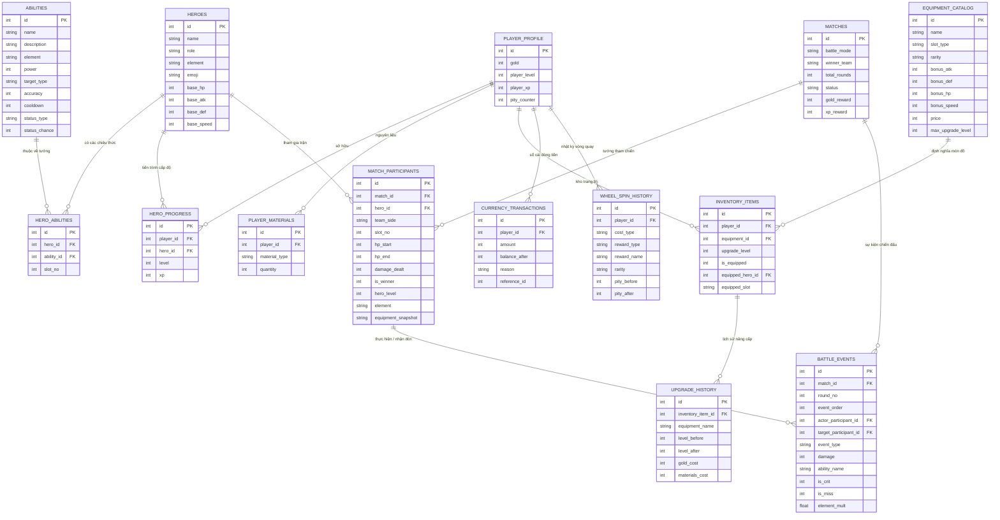

# ⚔️ TACTICAL BATTLE ARENA RPG & META TRACKER

> **Một Web Game RPG Chiến Đấu Theo Lượt Chiến Thuật (Pokémon-like) kết hợp Hệ Thống Trang Bị (Free Fire-inspired), Phát Triển Tướng, Vòng Quay May Mắn và Hệ Thống Phân Tích Dữ Liệu Thời Gian Thực.**  
> *Tài liệu kỹ thuật và hướng dẫn chuyên sâu dành cho sinh viên năm 2 ngành Kỹ thuật Dữ liệu (Data Engineering) và Lập trình Ứng dụng.*

---

## 📑 Mục lục
1. [Giới thiệu dự án & Mục tiêu học tập](#1-giới-thiệu-dự-án--mục-tiêu-học-tập)
2. [Cài đặt & Khởi chạy trên Windows](#2-cài-đặt--khởi-chạy-trên-windows)
3. [Cấu trúc mã nguồn & Phân chia trách nhiệm](#3-cấu-trúc-mã-nguồn--phân-chia-trách-nhiệm)
4. [Thiết kế Cơ sở Dữ liệu Quan hệ (ERD - 12 Bảng)](#4-thiết-kế-cơ-sở-dữ-liệu-quan-hệ-erd---12-bảng)
5. [Giải thích Khóa chính, Khóa ngoại, Bảng liên kết & Snapshot Dữ liệu](#5-giải-thích-khóa-chính-khóa-ngoại-bảng-liên-kết--snapshot-dữ-liệu)
6. [Các Luồng Dữ liệu (Data Pipelines)](#6-các-luồng-dữ-liệu-data-pipelines)
   - [6.1 Luồng Chiến Đấu (Tactical & Auto) -> SQLite](#61-luồng-chiến-đấu-tactical--auto---sqlite)
   - [6.2 Luồng Mua Sắm Shop -> Inventory & Currency Ledger](#62-luồng-mua-sắm-shop---inventory--currency-ledger)
   - [6.3 Luồng Cường Hóa Trang Bị (+1 đến +5)](#63-luồng-cường-hóa-trang-bị-1-đến-5)
   - [6.4 Luồng Vòng Quay May Mắn (Lucky Wheel) & Cơ Chế Bảo Hiểm Pity](#64-luồng-vòng-quay-may-mắn-lucky-wheel--cơ-chế-bảo-hiểm-pity)
7. [Các câu truy vấn SQL tiêu biểu cho Data Analytics](#7-các-câu-truy-vấn-sql-tiêu-biểu-cho-data-analytics)
8. [Kiểm thử tự động (Unit Tests & End-to-End Verification)](#8-kiểm-thử-tự-động-unit-tests--end-to-end-verification)
9. [Giới hạn hiện tại & Hướng phát triển theo ngành Data Engineering](#9-giới-hạn-hiện-tại--hướng-phát-triển-theo-ngành-data-engineering)

---

## 1. Giới thiệu dự án & Mục tiêu học tập

**TACTICAL BATTLE ARENA RPG** là phiên bản nâng cấp toàn diện của hệ thống Auto-Battle Arena. Dự án kết hợp hài hòa giữa gameplay chiến thuật RPG và kiến trúc kỹ thuật dữ liệu thực tế:

1. **Chiến đấu theo lượt phong cách Pokémon:**
   - Người chơi tự tay điều khiển từng tướng, chọn trong 4 chiêu thức riêng biệt, chọn mục tiêu trực quan trên chiến trường 2D.
   - Vòng tròn tương khắc nguyên tố kinh điển: `FIRE (Lửa) > NATURE (Tự nhiên) > WATER (Nước) > FIRE (Lửa)`. Đòn khắc hệ gây **x1.5 sát thương**, đòn bị kháng chỉ gây **x0.75 sát thương**.
   - 5 trạng thái hiệu ứng chiến đấu: `BURN` (sát thương đốt theo hiệp), `STUN` (choáng bỏ lượt), `SHIELD` (khiên ảo hấp thụ sát thương), `MARKED` (dấu ấn nhận thêm sát thương), `HEAL` (hồi phục máu).
   - AI đối thủ (RED) sử dụng hệ thống tính điểm heuristic (nhắm tướng yếu máu, chọn chiêu khắc hệ, hồi máu khi đồng đội nguy cấp).
   - Cả hai chế độ **Tactical Mode** và **Auto Mode** dùng chung một **Battle Engine cốt lõi**.

2. **Hệ thống phát triển nhân vật (Character Progression):**
   - Tướng tích lũy XP sau mỗi trận đấu để thăng cấp (Level 1 - 20).
   - Chỉ số tăng trưởng theo vai trò chuyên biệt: Knight/Guardian tăng mạnh HP & DEF; Mage/Assassin tăng mạnh ATK & Crit; Archer tăng Accuracy; Healer tăng ATK phép & Hỗ trợ.

3. **Hệ thống trang bị lấy cảm hứng từ Free Fire:**
   - 4 vị trí trang bị: `WEAPON` (Vũ khí), `ARMOR` (Giáp), `BOOTS` (Giày), `ACCESSORY` (Phụ kiện).
   - 4 cấp độ hiếm: `COMMON` (Xám), `RARE` (Xanh dương), `EPIC` (Tím), `LEGENDARY` (Vàng hoàng kim).
   - Các thuộc tính ảnh hưởng trực tiếp đến trận chiến: `BONUS_ATK`, `BONUS_DEF`, `BONUS_HP`, `BONUS_SPEED`, `BONUS_ACCURACY`, `BONUS_CRIT_RATE`, `BONUS_CRIT_DAMAGE`, `ARMOR_PENETRATION`, `ELEMENT_BONUS`.
   - Cường hóa trang bị từ `+0` đến tối đa `+5` (mỗi cấp tăng thêm 15% tất cả chỉ số gốc của trang bị).

4. **Nền kinh tế & Vòng quay may mắn (Lucky Wheel):**
   - Hồ sơ người chơi với đơn vị tiền tệ **Gold** và các nguyên liệu nâng cấp: *Đá Cường Hóa (Upgrade Stone)*, *Tinh Thể Nguyên Tố (Element Crystal)*, *Vé Quay May Mắn (Lucky Spin Ticket)*.
   - Cơ chế bảo hiểm Pity: Sau 10 lượt quay không trúng Epic/Legendary, lượt thứ 11 chắc chắn nhận trang bị EPIC hoặc LEGENDARY.
   - Sổ cái tài chính (`currency_transactions`) kiểm toán mọi dòng tiền ra/vào với số dư đối chiếu minh bạch.

5. **Giá trị học tập cốt lõi cho sinh viên Kỹ thuật Dữ liệu:**
   - **Mô hình hóa dữ liệu quan hệ (Relational Data Modeling):** Thiết kế 12 bảng chuẩn hóa với PK, FK, Junction Table và ràng buộc duy nhất.
   - **Bảo toàn lịch sử bằng Snapshot dữ liệu:** Lưu lại cấu hình trang bị và chỉ số tại thời điểm trận đấu diễn ra, không để việc thăng cấp trong tương lai làm sai lệch lịch sử trận cũ.
   - **Xử lý giao dịch ACID (OLTP):** Áp dụng Database Transaction bảo đảm tính nhất quán khi mua sắm, cường hóa, quay thưởng và lưu kết quả trận đấu.
   - **Phân tích dữ liệu bằng SQL nâng cao (OLAP Analytics):** Viết truy vấn `GROUP BY`, `JOIN`, `CASE WHEN`, CTE đệ quy, chuẩn hóa chuỗi để trích xuất Meta tướng, Meta hệ nguyên tố, Meta trang bị và kiểm định xác suất vòng quay.

---

## 2. Cài đặt & Khởi chạy trên Windows

Ứng dụng được thiết kế tối ưu trên Windows, sử dụng **Python standard library** kết hợp với **Flask**.

### Bước 1: Mở Terminal tại thư mục dự án
Mở PowerShell:
```powershell
cd "d:\Game lấy dữ liệu"
```

### Bước 2: Tạo và kích hoạt Môi trường ảo (Virtual Environment)
```powershell
python -m venv venv
.\venv\Scripts\Activate.ps1
```
*(Nếu PowerShell báo lỗi script execution policy, chạy: `Set-ExecutionPolicy -Scope Process -ExecutionPolicy Bypass` rồi kích hoạt lại).*

### Bước 3: Cài đặt thư viện
```powershell
pip install -r requirements.txt
```
> **Lưu ý:** Dự án chỉ sử dụng `Flask==3.0.3` (hoặc tương đương). Thư viện `sqlite3`, `json`, `urllib`, `random`, `unittest` đều có sẵn trong Python chuẩn.

### Bước 4: Khởi động Server Flask
```powershell
python app.py
```
Bạn sẽ thấy thông báo trên console:
```text
[SERVER] Tactical Battle Arena RPG dang chay tai: http://127.0.0.1:5000
 * Serving Flask app 'app'
 * Running on http://127.0.0.1:5000
```

### Bước 5: Trải nghiệm game trên trình duyệt
Mở trình duyệt (Chrome / Edge / Firefox) và truy cập:
👉 **`http://127.0.0.1:5000`**

Giao diện bao gồm 8 phân hệ chuyên biệt:
1. **ARENA:** Chiến đấu 3v3 (Tactical Mode chọn chiêu + mục tiêu trực quan, hoặc Auto Mode).
2. **HEROES:** Quản lý cấp độ, thanh XP, 4 kỹ năng và chỉ số sau trang bị của 8 vị tướng.
3. **EQUIPMENT:** Kho đồ, lọc theo Slot/Độ hiếm, trang bị/tháo đồ và cường hóa lên +1 đến +5.
4. **SHOP:** Cửa hàng vũ khí, giáp, giày, phụ kiện và các gói nguyên liệu nâng cấp.
5. **LUCKY WHEEL:** Vòng quay may mắn đồ họa Canvas, tỷ lệ công khai và cơ chế bảo hiểm Pity.
6. **META TRACKER:** Dashboard biểu đồ Chart.js thống kê Meta tướng, đội hình, hệ nguyên tố, trang bị và vòng quay.
7. **MATCH HISTORY:** Lịch sử tất cả trận đấu, xem lại toàn bộ Battle Log và chi tiết từng hiệp.
8. **PLAYER PROFILE:** Xem cấp độ người chơi, số dư Gold, kho nguyên liệu và sổ cái giao dịch tài chính.

---

## 3. Cấu trúc mã nguồn & Phân chia trách nhiệm

Dự án được tổ chức theo kiến trúc phân tầng rõ ràng (Separation of Concerns):

```text
d:\Game lấy dữ liệu\
├── app.py                  # Khởi tạo Flask server, định tuyến REST API (Battle, Shop, Wheel, Analytics)
├── database.py             # Kết nối SQLite, Migration an toàn, Seed dữ liệu khởi tạo, Transaction lưu trận
├── battle_engine.py        # Động cơ tính sát thương, chiêu thức, khắc hệ, trạng thái, TacticalBattleManager
├── ai_engine.py            # Trí tuệ nhân tạo đối thủ (RED): đánh giá điểm mục tiêu, khắc hệ, hồi máu
├── hero_service.py         # Quản lý cấp độ tướng, tăng trưởng chỉ số theo vai trò, tổng hợp chỉ số đồ
├── equipment_service.py    # Quản lý kho đồ, trang bị/tháo đồ theo slot, thuật toán cường hóa (+1 đến +5)
├── shop_service.py         # Danh mục cửa hàng, mua trang bị & nguyên liệu qua Transaction
├── lucky_wheel_service.py  # Vòng quay may mắn, thuật toán xác suất phân phối, cơ chế Pity 10 lượt
├── analytics.py            # Trích xuất dữ liệu phân tích bằng các câu truy vấn SQL chuyên sâu
├── requirements.txt        # Danh sách thư viện phụ thuộc (Flask)
├── verify_app.py           # Script tự động kiểm tra End-to-End toàn bộ 11 luồng API và CSDL
├── instance/
│   └── arena.db            # Cơ sở dữ liệu SQLite thực tế lưu trữ toàn bộ dữ liệu
├── templates/
│   └── index.html          # Giao diện web hoàn chỉnh với 8 Tab, chiến trường 2D, Canvas vòng quay
├── static/
│   ├── css/
│   │   └── style.css       # Phong cách Dark Fantasy RPG, viền độ hiếm Free Fire, hiệu ứng phát sáng
│   └── js/
│       └── app.js          # Controller JavaScript: điều khiển chiến trường, nhấp chọn mục tiêu, Chart.js
└── tests/
    ├── test_battle_engine.py # Unit tests kiểm tra công thức sát thương, khắc hệ, hiệu ứng trạng thái
    ├── test_tactical_rpg.py   # Unit tests kiểm tra Level, Slot trang bị, Cường hóa, Shop, Pity Wheel
    └── test_analytics.py      # Unit tests kiểm tra tính chính xác của các truy vấn SQL Analytics
```

---

## 4. Thiết kế Cơ sở Dữ liệu Quan hệ (ERD - 12 Bảng)

Hệ thống cơ sở dữ liệu được lưu trữ tại `instance/arena.db` gồm 12 bảng quan hệ:



---

## 5. Giải thích Khóa chính, Khóa ngoại, Bảng liên kết & Snapshot Dữ liệu

Là sinh viên Kỹ thuật Dữ liệu, việc hiểu rõ các khái niệm thiết kế CSDL trong dự án này là cực kỳ quan trọng:

### 5.1 Khóa chính (Primary Key - PK)
- Là trường định danh duy nhất cho mỗi bản ghi trong một bảng (ví dụ: `heroes.id`, `matches.id`, `inventory_items.id`).
- Tất cả các bảng trong hệ thống đều dùng kiểu số nguyên tự tăng (`INTEGER PRIMARY KEY AUTOINCREMENT`) để tối ưu tốc độ lập chỉ mục (B-Tree Indexing).

### 5.2 Khóa ngoại (Foreign Key - FK) & Ràng buộc toàn vẹn
- Khóa ngoại liên kết một bản ghi ở bảng con tới bảng cha tương ứng.
- Ví dụ: `inventory_items.equipment_id` tham chiếu tới `equipment_catalog.id`. Bạn không thể tạo một món đồ trong kho trỏ tới một mã trang bị không tồn tại.
- Để kích hoạt tính năng kiểm tra khóa ngoại trong SQLite, mỗi kết nối đều được thực thi:
  ```python
  conn.execute("PRAGMA foreign_keys = ON;")
  ```

### 5.3 Bảng liên kết (Junction Table)
- Trong mối quan hệ **Nhiều - Nhiều (Many-to-Many)** giữa Tướng và Kỹ năng (Một vị tướng có thể có nhiều kỹ năng, và một kỹ năng có thể được dùng chung cho nhiều tướng):
  - Bảng liên kết `hero_abilities` xuất hiện để phân giải mối quan hệ này:
  ```sql
  CREATE TABLE hero_abilities (
      id INTEGER PRIMARY KEY AUTOINCREMENT,
      hero_id INTEGER NOT NULL REFERENCES heroes(id),
      ability_id INTEGER NOT NULL REFERENCES abilities(id),
      slot_no INTEGER NOT NULL,
      UNIQUE(hero_id, slot_no),
      UNIQUE(hero_id, ability_id)
  );
  ```
  - Ràng buộc `UNIQUE(hero_id, slot_no)` bảo đảm một tướng không thể gắn 2 chiêu vào cùng 1 ô kỹ năng.

### 5.4 Snapshot Dữ liệu (Historical Data Preservation)
- **Vấn đề thực tế:** Giả sử Tướng A tham gia Trận đấu số 5 khi đang ở **Level 1** và chỉ mang một thanh kiếm gỉ. Sau đó 3 ngày, người chơi nâng Tướng A lên **Level 15** và trang bị gươm Thần thoại. Nếu bảng `match_participants` chỉ lưu `hero_id` và truy vấn động ngược lại bảng `heroes`, thì dữ liệu thống kê của Trận số 5 trong quá khứ sẽ bị sai lệch hoàn toàn!
- **Giải pháp Data Engineering:** Áp dụng kỹ thuật **Data Snapshot**:
  - Tại thời điểm bắt đầu trận đấu, toàn bộ chỉ số thực tế (`hp_start`, `hero_level`, `element`) và cấu hình trang bị lúc đó (`equipment_snapshot`) được sao chép và đóng băng ngay trong bảng `match_participants`.
  - Nhờ đó, lịch sử trận đấu là bất biến, phản ánh trung thực trạng thái tại thời điểm diễn ra sự kiện.

---

## 6. Các Luồng Dữ liệu (Data Pipelines)

### 6.1 Luồng Chiến Đấu (Tactical & Auto) -> SQLite

```text
[Người chơi chọn Chiêu & Mục tiêu]  hoặc  [AI Engine ra quyết định]
                        │
                        ▼
            [Battle Engine core math]
        - Khắc hệ (1.5x / 0.75x / 1.0x)
        - Độ chính xác & Né đòn (Accuracy vs Miss)
        - Chí mạng (Crit Rate & Crit Damage)
        - Giáp & Xuyên giáp (DEF - Armor Pen)
        - Hấp thụ khiên (Shield Absorption)
        - Áp dụng trạng thái (Burn, Stun, Marked, Heal)
                        │
                        ▼
      [State Machine: active_tactical_battles]
                        │
         (Khi trận đấu kết thúc COMPLETED)
                        │
                        ▼
      [Atomic Transaction: save_battle_result]
        ├── Ghi vào bảng `matches` (Mode, Winner, Rounds, Gold, XP)
        ├── Ghi 6 bản ghi vào `match_participants` kèm Stat & Gear Snapshot
        ├── Ghi chuỗi sự kiện chi tiết vào `battle_events`
        ├── Cộng XP cho các tướng trong `hero_progress` (xét lên cấp)
        ├── Cộng thưởng Gold vào `player_profile`
        └── Ghi dòng tiền thưởng vào `currency_transactions`
```

### 6.2 Luồng Mua Sắm Shop -> Inventory & Currency Ledger

```text
[Yêu cầu mua POST /api/shop/buy]
                 │
                 ▼
[Kiểm tra số dư: player_profile.gold >= item.price ?]
        ├── KHÔNG ĐỦ ──> Trả về HTTP 400 "Không đủ Gold!", Rollback ngay lập tức
        └── ĐỦ VÀNG ───> Thực thi Atomic Transaction:
                             ├── Trừ Gold trong `player_profile`
                             ├── Tạo món đồ mới trong `inventory_items` (hoặc cộng nguyên liệu)
                             └── Ghi giao dịch âm vào `currency_transactions`
```

### 6.3 Luồng Cường Hóa Trang Bị (+1 đến +5)

```text
Cấp độ hiện tại:   +0 ──> +1 ──> +2 ──> +3 ──> +4 ──> +5 (Tối đa)
Chi phí Gold:     120    220    360    550    800
Đá Cường Hóa:       1      1      2      2      3
Tinh Thể N.Tố:      0      0      0      1      2
Chỉ số tăng:     +15%   +30%   +45%   +60%   +75% (so với chỉ số gốc)
```
- Hệ thống kiểm tra đồng thời cả 3 tài nguyên (Gold, Đá Cường Hóa, Tinh Thể Nguyên Tố).
- Nếu hợp lệ, tăng `upgrade_level`, trừ tài nguyên, ghi nhận vào `upgrade_history` và sổ cái tài chính.

### 6.4 Luồng Vòng Quay May Mắn (Lucky Wheel) & Cơ Chế Bảo Hiểm Pity

Tỷ lệ giải thưởng được công khai minh bạch:
| Loại phần thưởng | Tỷ lệ công khai | Chi tiết nhận được |
| :--- | :---: | :--- |
| **Vàng (Gold)** | **45%** | 120 đến 350 Gold cộng thẳng vào ví |
| **Nguyên Liệu Nâng Cấp** | **25%** | Đá Cường Hóa, Tinh Thể Nguyên Tố, hoặc Vé Quay |
| **Trang Bị COMMON** | **15%** | Vũ khí, Giáp, Giày hoặc Nhẫn thường |
| **Trang Bị RARE** | **8%** | Trang bị hiếm với chỉ số vượt trội |
| **Trang Bị EPIC** | **5%** | Trang bị tím chỉ số cao |
| **Trang Bị LEGENDARY** | **2%** | Cực phẩm hoàng kim (Excalibur, Dragon Armor, Hermes Boots) |
| **Tổng cộng** | **100%** | |

**Cơ chế Bảo hiểm Pity (Pity System):**
- Mỗi lần quay không ra EPIC hoặc LEGENDARY, biến `pity_counter` tăng thêm 1.
- Khi `pity_counter >= 10`: Lượt quay tiếp theo **chắc chắn kích hoạt bảo hiểm (100% ra EPIC hoặc LEGENDARY)** với tỷ lệ 75% Epic và 25% Legendary!
- Khi nhận được đồ Epic hoặc Legendary, `pity_counter` được đặt lại về 0.

---

## 7. Các câu truy vấn SQL tiêu biểu cho Data Analytics

Trong tệp `analytics.py`, toàn bộ các chỉ số hiển thị trên giao diện đều được tính toán trực tiếp từ CSDL SQLite bằng các câu lệnh SQL chuẩn mực:

### 7.1 Tính Win Rate và Sát thương trung bình của từng Tướng
```sql
SELECT 
    h.id,
    h.name,
    h.role,
    h.element,
    h.emoji,
    COUNT(mp.id) AS total_picks,
    COALESCE(SUM(mp.is_winner), 0) AS total_wins,
    CASE 
        WHEN COUNT(mp.id) > 0 THEN ROUND(100.0 * SUM(mp.is_winner) / COUNT(mp.id), 1)
        ELSE 0.0 
    END AS win_rate,
    COALESCE(SUM(mp.damage_dealt), 0) AS total_damage,
    CASE 
        WHEN COUNT(mp.id) > 0 THEN ROUND(1.0 * SUM(mp.damage_dealt) / COUNT(mp.id), 1)
        ELSE 0.0 
    END AS avg_damage,
    COALESCE(hp.level, 1) as current_level
FROM heroes h
LEFT JOIN match_participants mp ON h.id = mp.hero_id
LEFT JOIN hero_progress hp ON h.id = hp.hero_id AND hp.player_id = 1
WHERE h.is_active = 1
GROUP BY h.id, h.name, h.role, h.element, h.emoji, hp.level
ORDER BY total_picks DESC, win_rate DESC;
```

### 7.2 Phân tích Tương quan Hệ Nguyên tố (Fire vs Water vs Nature)
```sql
SELECT 
    h.element,
    COUNT(mp.id) AS total_picks,
    COALESCE(SUM(mp.is_winner), 0) AS total_wins,
    CASE 
        WHEN COUNT(mp.id) > 0 THEN ROUND(100.0 * SUM(mp.is_winner) / COUNT(mp.id), 1)
        ELSE 0.0 
    END AS win_rate,
    ROUND(1.0 * SUM(mp.damage_dealt) / COUNT(mp.id), 1) AS avg_damage
FROM heroes h
JOIN match_participants mp ON h.id = mp.hero_id
GROUP BY h.element
ORDER BY total_picks DESC;
```

### 7.3 Phân tích Đội hình 3 tướng chuẩn hóa bằng CTE (Common Table Expression)
*Kỹ thuật Data Engineering:* Sắp xếp tên 3 tướng theo thứ tự bảng chữ cái (`ORDER BY h.name ASC`) rồi gom lại bằng `GROUP_CONCAT()`, bảo đảm đội hình `{Knight, Mage, Archer}` và `{Archer, Knight, Mage}` được chuẩn hóa thành một nhóm duy nhất:
```sql
WITH team_heroes AS (
    SELECT 
        mp.match_id, 
        mp.team_side, 
        mp.is_winner, 
        h.name,
        h.emoji
    FROM match_participants mp
    JOIN heroes h ON mp.hero_id = h.id
    ORDER BY mp.match_id, mp.team_side, h.name ASC
),
team_compositions AS (
    SELECT 
        match_id, 
        team_side, 
        is_winner,
        GROUP_CONCAT(name, ' + ') AS comp_name,
        GROUP_CONCAT(emoji, ' ') AS comp_emojis
    FROM team_heroes
    GROUP BY match_id, team_side
    HAVING COUNT(name) = 3
)
SELECT 
    comp_name,
    comp_emojis,
    COUNT(*) AS total_matches,
    SUM(is_winner) AS wins,
    ROUND(100.0 * SUM(is_winner) / COUNT(*), 1) AS win_rate
FROM team_compositions
GROUP BY comp_name, comp_emojis
ORDER BY total_matches DESC, win_rate DESC
LIMIT 10;
```

### 7.4 Kiểm định phân phối phần thưởng Vòng quay may mắn thực tế
```sql
SELECT 
    rarity,
    reward_type,
    COUNT(*) as total_spins_won,
    ROUND(100.0 * COUNT(*) / (SELECT COUNT(*) FROM wheel_spin_history WHERE player_id = 1), 1) as actual_percentage
FROM wheel_spin_history
WHERE player_id = 1
GROUP BY rarity, reward_type
ORDER BY total_spins_won DESC;
```

### 7.5 Kiểm toán Dòng tiền (Currency Ledger Audit)
```sql
SELECT 
    reason,
    COUNT(*) AS transaction_count,
    SUM(CASE WHEN amount > 0 THEN amount ELSE 0 END) AS total_gold_earned,
    SUM(CASE WHEN amount < 0 THEN ABS(amount) ELSE 0 END) AS total_gold_spent,
    SUM(amount) AS net_flow
FROM currency_transactions
WHERE player_id = 1
GROUP BY reason;
```

---

## 8. Kiểm thử tự động (Unit Tests & End-to-End Verification)

### 8.1 Chạy toàn bộ 15 Unit Tests
Dự án bao gồm 15 bài kiểm thử đơn vị độc lập bao phủ toàn bộ logic chiến đấu, cường hóa, shop và truy vấn CSDL:
```powershell
python -m unittest discover tests
```
Kết quả thực tế:
```text
...............
----------------------------------------------------------------------
Ran 15 tests in 22.919s

OK
```

### 8.2 Chạy kiểm tra tích hợp End-to-End (11 bước toàn diện)
Script `verify_app.py` giả lập toàn bộ hành vi người dùng trên server thực tế:
```powershell
python verify_app.py
```
Kết quả kiểm tra:
```text
==========================================================
   TACTICAL BATTLE ARENA RPG - END-TO-END VERIFICATION
==========================================================

--- 1. Checking Home Page (GET /) ---
  [PASS] Home page loaded with all 8 navigation tabs.

--- 2. Checking Heroes & Progress (GET /api/heroes) ---
  [PASS] Retrieved 8 heroes with abilities and progression.
         Sample: Knight (Lv.2, Element: WATER, 4 skills)

--- 3. Checking Player Profile & Economy (GET /api/player/profile) ---
  [PASS] Player Profile: Level 2, Gold: 230, Materials: {'ELEMENT_CRYSTAL': 2, 'LUCKY_TICKET': 1, 'UPGRADE_STONE': 4}

--- 4. Checking Shop Catalog & Item Purchase ---
  [INFO] Purchasing 'Bronze Ring' for 100 Gold...
  [PASS] Bought item successfully. Remaining Gold: 130

--- 5. Checking Inventory & Equipment Management ---
  [PASS] Inventory has 9 items. Selected: Bronze Ring (ACCESSORY, +2)
  [PASS] Equipped 'Bronze Ring' to hero ID 1.
  [INFO] Upgrade result: Không đủ Gold! Cần 360 Gold (Hiện có: 130).

--- 6. Checking Lucky Wheel (GET & POST /api/wheel) ---
  [PASS] Lucky Wheel configuration verified (Sum of odds: 100.0%). Pity count: 0/10
  [PASS] Lucky Wheel Spin Won (TICKET): 213 Gold (COMMON)! Remaining Gold: 343

--- 7. Checking Team Roll (POST /api/team/roll) ---
  [PASS] Rolled 3 distinct heroes: ['Archer', 'Mage', 'Berserker']

--- 8. Simulating Tactical Battle Flow (Turn-by-Turn Combat) ---
  [PASS] Tactical Battle #3 initialized with status 'WAITING_PLAYER'.
  [PASS] Tactical Battle finished in 12 player turns. Winner: BLUE (Status: COMPLETED)
         Saved to database with Match ID #23

--- 9. Simulating Auto Battle (POST /api/battle/fight) ---
  [PASS] Auto Battle #24 completed: Winner=RED, Rounds=8, Events=43

--- 10. Checking Comprehensive Analytics Endpoints ---
  [PASS] Overview: Total Matches=24, WinRate=66.7%
  [PASS] Element Meta: 3 elements analyzed: ['FIRE', 'WATER', 'NATURE']
  [PASS] Equipment Meta: 5 equipment items tracked in player inventory.
  [PASS] Wheel Analytics: 3 prize categories tracked in spin distribution.

--- 11. Checking Currency Ledger & Match History ---
  [PASS] Currency Ledger: 12 transactions recorded with positive/negative audit flow.
  [PASS] Match History: 24 matches recorded in SQLite.

==========================================================
   ALL 11 END-TO-END VERIFICATION CHECKS PASSED (100%)!
==========================================================
```

---

## 9. Giới hạn hiện tại & Hướng phát triển theo ngành Data Engineering

Dự án hiện tại là một nền tảng thực hành hoàn hảo cho mức độ sinh viên năm 2. Trong thực tế môi trường doanh nghiệp lớn, hệ thống có thể được mở rộng theo các hướng sau:

1. **Từ Single-file SQLite sang Client-Server RDBMS:**
   - Khi lượng người chơi đồng thời tăng lên hàng ngàn, chuyển đổi sang **PostgreSQL** với Connection Pooling (`PgBouncer`) để xử lý ghi nhận giao dịch đồng thời cao.
2. **Kiến trúc Data Warehouse & Star Schema:**
   - Tách biệt CSDL giao dịch (OLTP) và CSDL phân tích (OLAP).
   - Thiết kế lược đồ hình sao (Star Schema) với bảng sự kiện trung tâm `fact_battle_events` liên kết tới các bảng chiều `dim_heroes`, `dim_equipment`, `dim_time`, `dim_player`.
3. **ETL / ELT Pipelines tự động:**
   - Xây dựng luồng luân chuyển dữ liệu tự động bằng **Apache Airflow** hoặc **Prefect**: định kỳ nửa đêm gom dữ liệu trận đấu, tính sẵn các bảng tổng hợp (Aggregate Tables) để giảm tải cho database chính.
4. **Data Streaming thời gian thực:**
   - Ứng dụng **Apache Kafka** hoặc **RabbitMQ** để bắt kịp từng `battle_event` trực tiếp trong trận và đẩy vào **Elasticsearch** hoặc **ClickHouse** phục vụ tìm kiếm và hiển thị dashboard theo mili-giây.
5. **Machine Learning cho AI đối thủ:**
   - Huấn luyện mô hình Reinforcement Learning (Q-Learning / PPO) dựa trên lịch sử hàng chục ngàn trận đấu đã lưu trong CSDL để AI đối thủ ngày càng thông minh hơn thay vì chỉ dùng heuristic đơn giản.

---

*Chúc các bạn sinh viên học tập hiệu quả và có nhiều trải nghiệm thực hành bổ ích với dự án TACTICAL BATTLE ARENA RPG & META TRACKER!*
